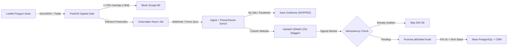

# Spatial Lead Hunter & Website Audit Engine
Geospatial B2B lead discovery, contact enrichment, and automated website auditing engine. Built to solve a common bottleneck for agencies prospecting local trades: burning scraping credits on overlapping territories, cold-calling office landlines, and manually running Lighthouse checks one site at a time. Converts drawn map polygons into **PostGIS** suburb batches, blocks duplicate territory scrapes within 30 days, enriches **Outscraper** results with mobile numbers and owner names, queues staggered **Google PageSpeed** and CMS audits through **Upstash QStash**, and generates tailored cold outreach pitches in a single CRM dashboard.

## End-to-End Request Flow

## Key Engineering & Hardening Decisions
* **PostGIS Territory Deduplication:** Normalizes trade synonyms (e.g., `plumber`, `gas fit`, `drain` -> `plumbing`) and computes geodesic polygon overlap (`ST_Intersection` / `ST_Area::geography`) against prior `SearchCampaign` geometries. Any territory with >=70% overlap inside a 30-day window is blocked before hitting Outscraper, preventing duplicate credit spend.
* **Two-Bucket Triage & Zero-Waste Auditing:** Deduplicates incoming Google Maps records by `place_id` and splits leads on ingest. Businesses with no website or Facebook-only links are tagged as `SKIPPED` ("Goldmines") immediately, reserving PageSpeed and tech-stack worker runs strictly for custom domains.
* **ACMA Phone Classification & Owner Extraction:** Classifies Australian numbers against ACMA mobile (`04`/`+614`) and landline (`02/03/07/08/1300/1800`) prefixes. When Outscraper returns a landline or blank number, the enrichment pipeline scrapes the business homepage (5s timeout, 1MB cap) to recover a direct mobile number alongside heuristic owner-name extraction with `HIGH`/`MEDIUM`/`LOW` confidence tagging.
* **Staggered QStash Workers & Graceful Degradation:** Queues website audits asynchronously with staggered delays (15s on ingest, 5s on bulk re-queues up to 100 leads) to respect Google API rate limits and avoid Vercel timeouts. Workers verify `Upstash-Signature` headers, short-circuit already-audited leads idempotently, run PageSpeed Insights v5 (4 Lighthouse categories, LCP, and base64 mobile screenshot) alongside HTTP/HTML CMS fingerprinting concurrently via `Promise.allSettled()`, and record `SUCCESS`, `PARTIAL_FAIL`, or `FAILED` with structured `auditErrorLog` JSON while returning HTTP 200 so dead sites never trigger retry storms.
* **Resilient Job Tracking & Serverless Connection Pooling:** Persists active job IDs in `localStorage` for 5-second status polling across page reloads, paired with a manual `Force Sync` fallback (`/api/jobs/sync`) that polls Outscraper directly if a webhook callback is missed. Prisma ORM v7 runs through `@prisma/adapter-pg` with `pg.Pool` capped at `max: 10` connections to stay safely within Neon serverless limits.
* **Audit-Driven CRM & Instant Pitch Generation:** Surfaces mobile screenshots, Core Web Vitals, CMS badges (WordPress/Elementor/Divi, Wix, Squarespace, Shopify, Webflow), and phone-type filters in a paginated dashboard, with a 1-click pitch builder that branches copy automatically between slow-website audits and no-website "Goldmine" prospects.

## Tech Stack
* **Framework & UI:** Next.js 16 (App Router, Turbopack), React 19, TypeScript, Tailwind CSS v4 (hosted on Vercel)
* **Geospatial & Mapping:** PostGIS, Leaflet, `leaflet-draw`, OpenStreetMap tiles
* **Database & Queues:** Neon PostgreSQL, Prisma ORM v7 (`@prisma/adapter-pg`), Upstash QStash
* **Discovery & Auditing:** Outscraper Google Maps API, Google PageSpeed Insights v5, Axios
